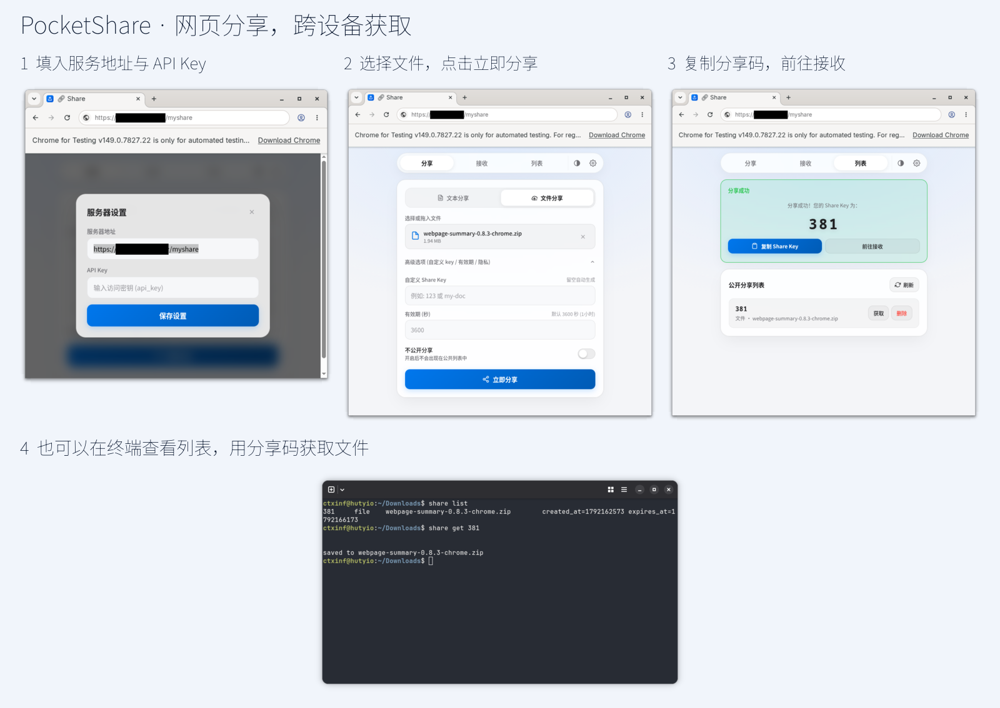
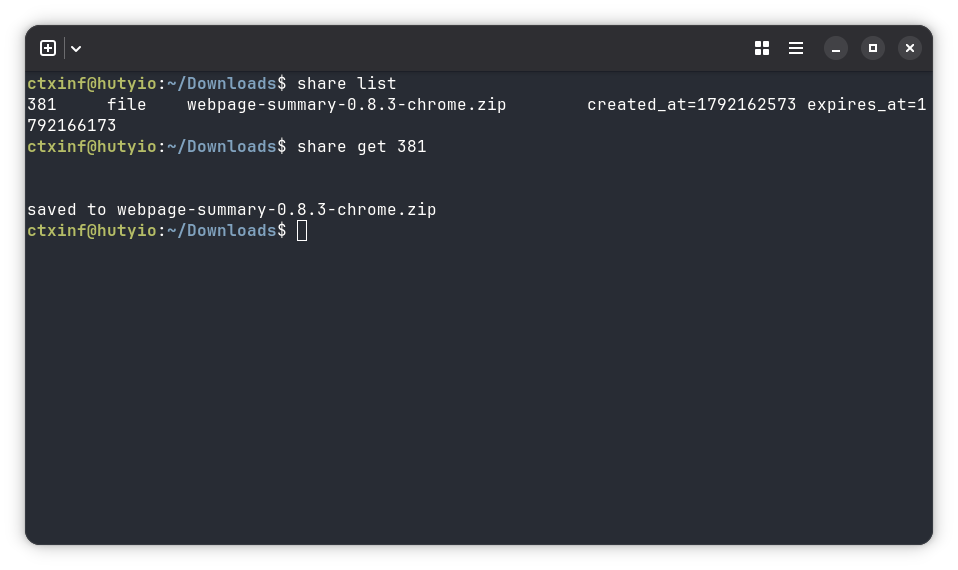

<h1 align="center"> PocketShare</h1>
<p align="center"><a href="README.md">中文</a> · English</p>

<p align="center">A self-hosted tool for personal use. Share text and files across devices.</p>



- Plain HTTP with a simple C/S architecture, straightforward interactions and broad compatibility.
- Web client: simple, works across devices, with mobile layouts and PWA support.
- CLI client: convenient terminal access, also usable by agents.
- Built with Rust, with low resource usage: server **5.1 MB**, CLI **4.1 MB**, idle server memory approximately **7 MiB**.
- Simple to use: API Key authentication only, with no accounts or user management.


## Contents

- [1. Installation](#1-installation)
  - [1. Docker](#1-docker)
  - [2. Binaries/systemd](#2-binariessystemd)
    - [2.1 Install with a script](#21-install-with-a-script)
    - [2.2 Download directly](#22-download-directly)
    - [2.3 Local installation](#23-local-installation)
  - [3. CLI installation](#3-cli-installation)
- [2. Usage](#2-usage)
- [3. Comparison](#3-comparison)

## 1. Installation

<details id="1-docker">
<summary>1. Docker</summary>

Save as `compose.yml`:

```yaml
services:
  pocketshare:
    image: ghcr.io/ctxinf/pocketshare:latest
    ports:
      - "127.0.0.1:3000:3000"
    volumes:
      - pocketshare-data:/data
    restart: unless-stopped
volumes:
  pocketshare-data:
```

```sh
docker compose up -d
docker compose exec pocketshare cat /data/api_key
```

Open `http://localhost:3000` and enter the API Key. Data persists in the volume. For internet access, place an HTTPS reverse proxy in front of `127.0.0.1:3000`. Installing the PWA requires HTTPS or localhost.

</details>

<details id="2-binariessystemd">
<summary>2. Binaries/systemd</summary>

The server binary is `pocket-share-server`; the CLI uses the shorter name `pshare` for convenient typing.

<details id="21-install-with-a-script">
<summary>2.1 Install with a script</summary>

Linux / macOS; installs the server to `~/.local/bin`, without Rust:

```sh
curl -fsSL https://raw.githubusercontent.com/ctxinf/PocketShare/main/deploy/install-server.sh | sh
export PATH="$HOME/.local/bin:$PATH"
pocket-share-server
```

On Linux, stop the foreground server and install the systemd user service:

```sh
bash ~/.local/bin/pocketshare-systemd/deploy.sh
```

To pin a version, download the script and run `VERSION=v0.1.0 sh install-server.sh`.

</details>

<details id="22-download-directly">
<summary>2.2 Download directly</summary>

Download your OS/architecture from [Releases](https://github.com/ctxinf/PocketShare/releases/latest), extract, and run `bin/pocket-share-server` (`.exe` on Windows). The CLI is `bin/pshare`. On Linux, `bash deploy.sh` installs a systemd user service.

The first run creates configuration and an API Key; startup logs show their locations. Restart after changing configuration. See the [deployment guide](deploy/systemd/package-usage.md) for systemd details.

</details>

<details id="23-local-installation">
<summary>2.3 Local installation</summary>

Install the Rust toolchain and C/C++ build tools, then build the server from source:

```sh
git clone https://github.com/ctxinf/PocketShare.git
cd PocketShare
cargo build --release --locked --manifest-path server/Cargo.toml
mkdir -p ~/.local/bin
install -m 755 server/target/release/pocket-share-server ~/.local/bin/
export PATH="$HOME/.local/bin:$PATH"
pocket-share-server
```

</details>

</details>

<details id="3-cli-installation">
<summary>3. CLI installation</summary>

Install `pshare` separately on Linux / macOS, without the server or Rust:

```sh
curl -fsSL https://raw.githubusercontent.com/ctxinf/PocketShare/main/deploy/install-cli.sh | sh
export PATH="$HOME/.local/bin:$PATH"
pshare login <API_KEY> --server https://share.example.com
```

Alternatively, download `bin/pshare` (`bin/pshare.exe` on Windows) from [Releases](https://github.com/ctxinf/PocketShare/releases/latest), or build from the repository root:

```sh
cargo build --release --locked --manifest-path cli/Cargo.toml
install -m 755 cli/target/release/pshare ~/.local/bin/
```

</details>

## 2. Usage

<details>
<summary>1. Open Settings and enter the API Key</summary>

The server address defaults to the current page address. Use the same server and API Key on each device.


</details>

<details>
<summary>2. Enter text or select a file, then share</summary>

Copy the share code. Set an expiry in advanced options.


</details>

<details>
<summary>3. Enter the code on another device</summary>

Copy the text or download the file.


</details>

<details>
<summary>4. View, receive or delete shares from the list</summary>

Private shares are accessible by code and hidden from the list.


</details>

<details>
<summary>5. Share and receive from the terminal</summary>



```bash
pshare login <API_KEY> --server https://share.example.com
pshare put 'hello'
pshare put ./photo.png
cat notes.txt | pshare put
pshare get <CODE>
pshare get <CODE> --link
pshare list
pshare delete <CODE>
```

</details>

## 3. Comparison

| Alternative | Approach | PocketShare |
| --- | --- | --- |
| WeChat File Transfer | Cloud service | Self-hosted alternative |
| [LocalSend](https://localsend.org/) | LAN sharing, device discovery | HTTP server over the internet |
| [PocketChest](https://github.com/Hzao/PocketChest) | Serverless | Runs on your own machine |
