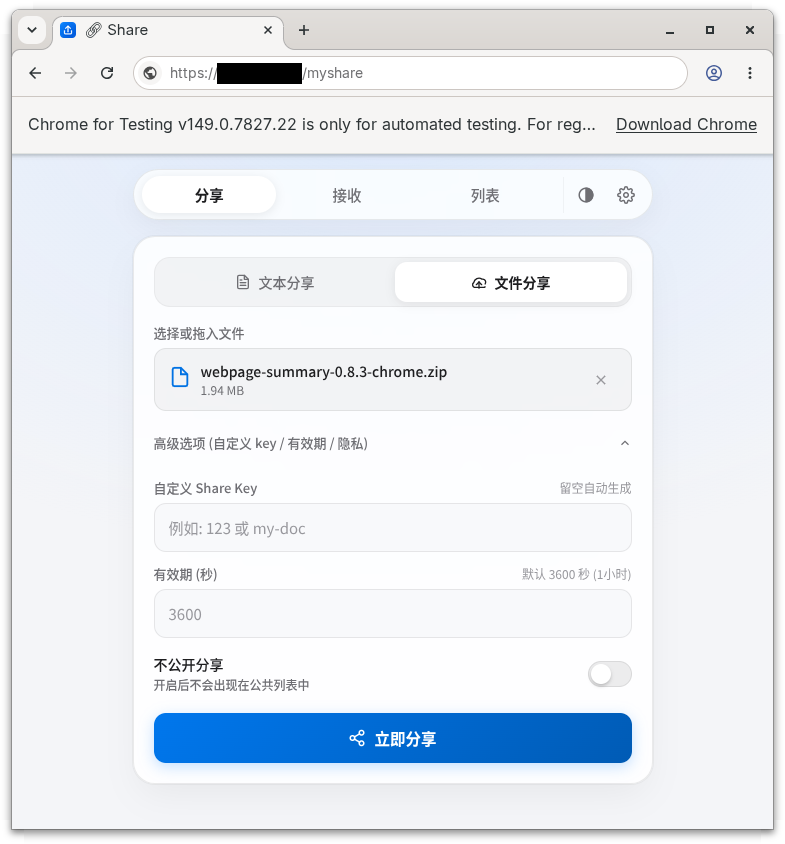
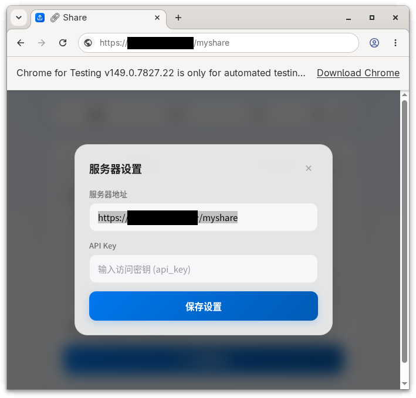

# PocketShare

面向个人自用的自托管多端分享工具。把文本、文件从终端发出去，在另一台电脑或手机上接收，走互联网也一样。

- Rust 服务端，内嵌 Web 客户端与 PWA；另有 `pshare` CLI，支持管道、上传进度和重试。
- 简单的 HTTP C/S 架构，无局域网发现；需要一台机器部署服务。
- 无注册、无用户管理，仅 API Key 鉴权。支持分享码、过期清理和临时下载链接。

[LocalSend](https://localsend.org/) 面向局域网设备直传，[PocketChest](https://github.com/Hzao/PocketChest) 部署在 Cloudflare serverless；PocketShare 则在自己的机器上运行 HTTP 服务，供各端经互联网访问。

Linux amd64 实测（Rust 1.88，release + strip）：服务端 **5.1 MB**，CLI **4.1 MB**；容器内服务空闲 RSS 约 **7 MiB**，上传时随文件大小增加。

## 效果展示



## 安装

### Docker

```bash
git clone https://github.com/ctxinf/PocketShare.git
cd PocketShare
docker compose -f deploy/docker/compose.yaml up -d
docker compose -f deploy/docker/compose.yaml exec pocketshare cat /data/api_key
```

打开 `http://localhost:3000`，填入 API Key。数据保存在 Docker volume 中。公网使用时，在前面配置 HTTPS 反向代理，指向 `127.0.0.1:3000`；PWA 安装需要 HTTPS 或 localhost。

本地构建：

```bash
docker compose -f deploy/docker/compose.yaml up -d --build
```

自定义配置：修改 [config.toml](deploy/docker/config.toml)，在 Compose 的 `volumes` 中增加 `./config.toml:/etc/pocketshare/config.toml:ro`，然后重新创建容器。

### 二进制 / systemd

有 Rust 工具链时：

```bash
./deploy/systemd/zip.sh
unzip dist/PocketShare-0.1.0.zip
cd PocketShare-0.1.0
./deploy.sh
```

打包产物也可拷贝到相同 OS / 架构的机器部署。详见 [systemd 部署说明](deploy/systemd/package-usage.md)。仅安装 CLI：`./deploy/systemd/install-cli.sh`。

## 使用

<details>
<summary>1. 打开网页，在设置中填入 API Key</summary>

服务地址默认为当前页面地址；各设备使用同一个服务和 API Key。



</details>

<details>
<summary>2. 输入文本或选择文件，点击「立即分享」</summary>

获得分享码；可在高级选项中设置有效期。


</details>

<details>
<summary>3. 在另一台设备输入分享码，接收内容</summary>

文本可复制，文件可下载。


</details>

<details>
<summary>4. 在列表中查看、接收或删除分享</summary>

私密分享不会出现在列表中，仍可通过分享码接收。


</details>

终端：

```bash
pshare login <API_KEY> --server https://share.example.com
pshare put 'hello'
pshare put ./photo.png
cat notes.txt | pshare put
pshare get <分享码>
pshare get <分享码> --link
pshare list
pshare delete <分享码>
```
